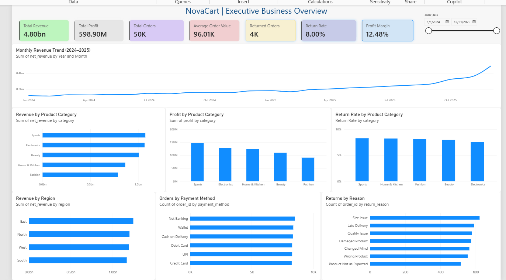

# NovaCart — E-Commerce Business Intelligence & Customer Analytics

An end-to-end data analytics portfolio project demonstrating how Python, MySQL, and Power BI can transform transactional data into validated KPIs, business insights, and executive reporting.

> **Project type:** Data Analytics & Business Intelligence  
> **Tools:** Python · Pandas · NumPy · MySQL 8.0 · SQL · Power BI · Git  
> **Reporting period:** 2024–2025  
> **Data:** Synthetic data generated for educational and portfolio purposes

## Project at a Glance

NovaCart simulates an e-commerce business and analyzes sales performance, profitability, customer behavior, regional performance, and product returns.

The project follows an end-to-end analytics workflow:

**Business Understanding → Data Generation → Data Quality → Data Cleaning → EDA → Statistical Analysis → SQL → Power BI → Business Insights**

## Verified Project Results

| KPI | Result |
|---|---:|
| Orders analyzed | 50,000 |
| Customers | 5,000 |
| Products | 200 |
| Returned orders | 4,000 |
| Net revenue | ₹4,800,360,544.59 |
| Total profit | ₹598,903,173.30 |
| Profit margin | 12.48% |
| Average order value | ₹96,007.21 |

The financial KPIs were verified using Python, and the Python-to-MySQL reconciliation confirmed that all 50,000 order IDs and the five compared financial metrics matched exactly.

## Key Business Findings

- **Revenue growth:** Net revenue increased by approximately 82.32% from 2024 to 2025.
- **Profit growth:** Total profit increased by approximately 80.71% over the same period.
- **Category performance:** Sports was the highest-performing category by revenue and profit in the analyzed data.
- **Regional performance:** The East region recorded the highest revenue.
- **Returns:** The overall return rate was 8.00%, with Size Issue identified as the most common return reason overall.

These findings describe the generated dataset and do not establish the causes of observed patterns.

## Executive Dashboard

The Power BI dashboard presents revenue trends, category performance, regional revenue, returns, payment methods, and return reasons.

**Interactive dashboard:** Open `PowerBI/NovaCart_Executive_Overview.pbix` in Power BI Desktop.

## Important Data Disclaimer

All datasets and results in this project are synthetic. They are not actual NovaCart company transactions or real customer records. The findings demonstrate analytical techniques and should not be interpreted as real-world business evidence.